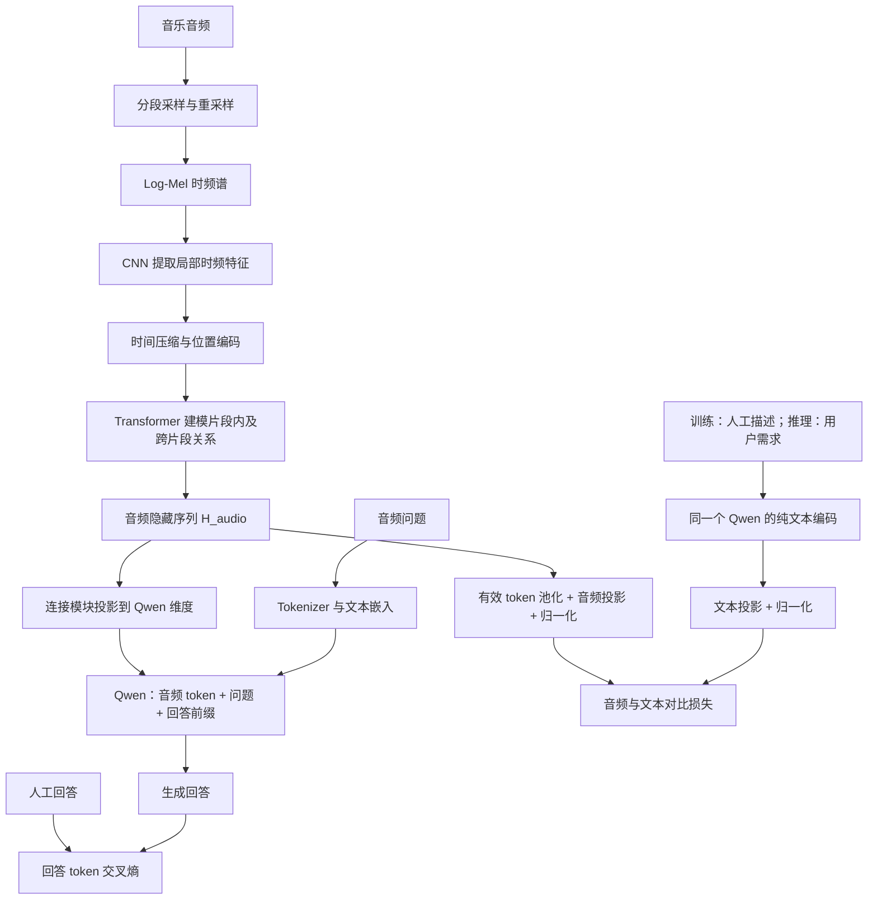

# 音乐音频问答与跨模态召回训练工程

这是为 **MuChin 音频与人工描述 + 本地 Qwen3-4B-Base** 准备的研究训练工程。输入音乐和问题，模型生成文字回答；另外用对齐损失训练音频、文本两侧的向量，以便将来接入多路召回系统。

主要实现：**CNN + Transformer 音频编码器 → 连接模块 → Qwen**。默认训练音频编码器、连接模块、检索投影层和 Qwen 的 LoRA 参数；也支持冻结 Qwen 或全参数微调。

**本工程已经完成小模型的真实前向、反向、保存、恢复和 API 检查，但还没有训练完整 6066 首音乐，也没有证明音乐理解或推荐效果。** 已附的曲线来自明确标记的合成音频自检。CNN/Transformer 默认随机初始化；Qwen 来自你提供的本地预训练权重。

建议先读本文，再按 [服务器训练与部署步骤](DEPLOYMENT.md) 操作。实时曲线、梯度诊断和音乐问答网页见 [WEB_GUIDE.md](WEB_GUIDE.md)，实际检查范围见 [检查报告](CHECK_REPORT.md)。

新版已加入 CNN/Transformer 的真实梯度与参数更新日志，以及训练监控和音乐检查网页。网页可以选测试歌曲、提问、查看 CNN 池化输出和 Transformer 隐藏序列、读取 Qwen 回答，并做静音对照和完整特征下载。

源码包不包含数据集、标注或模型权重。`MuChin/`、`Qwen3-4B-Base/` 是占位目录，默认服务器配置指向这两个目录；使用工程外的已有文件时修改路径即可。

## 1. 这套代码能做什么

| 功能 | 输入 | 输出 | 入口 |
| --- | --- | --- | --- |
| 音频问答训练 | 音频、问题、人工回答 | 训练权重、日志、曲线、检查点 | `music_train.train` |
| 音乐描述生成 | 一首音频、一个问题 | 回答文字 | `music_train.infer describe` |
| 音频向量建库 | 歌曲清单和音频 | 歌曲向量索引 | `music_train.infer index` |
| 文本召回 | 用户文字需求、歌曲索引 | 相似歌曲及分数 | `music_train.infer search` |
| 配对召回评估 | 留出集人工描述、歌曲索引 | Recall@1/5/10 | `music_train.infer evaluate` |
| HTTP 部署 | 上传音频或文本 | 描述或向量 | `music_train.serve` |
| 训练与检查网页 | 实验目录、测试清单、完整检查点 | 实时诊断、播放器、特征图和问答 | `music_train.dashboard` |

这是独立模型工程。原有 `recommendation_1` 保持原样；本项目训练成功后，可以把文本向量与音频向量召回作为它的一条新召回路径。这里不包含用户行为协同过滤、LLM 重排或 Agent 工具调度。

## 2. 文件结构树

```text
music_audio_training/
├── README.md                    # 架构、损失函数、学习导航
├── DEPLOYMENT.md                # Linux 服务器训练、恢复、评估、部署步骤
├── WEB_GUIDE.md                 # 实时网页、诊断指标、静音对照和特征下载
├── CHECK_REPORT.md              # 本地验证结果与尚未验证的内容
├── requirements.txt            # Python 依赖；CUDA 版 PyTorch 按服务器配置安装
├── pytest.ini                  # 测试入口配置
├── .gitignore
├── configs/
│   └── server.yaml             # 真实训练配置：路径、模型规模、学习率、LoRA
├── music_train/
│   ├── __init__.py
│   ├── config.py               # 带类型的配置类、参数校验、路径解析
│   ├── prepare.py              # MuChin 标注转换、按歌曲/录音组划分数据
│   ├── data.py                 # JSONL 校验、题目轮换、批次整理、防泄漏
│   ├── audio.py                # 分段读取、单声道、重采样、短音频掩码
│   ├── model.py                # CNN、Transformer、Qwen、问答和检索损失
│   ├── train.py                # 训练/验证、梯度累积、DDP、续训、日志
│   ├── diagnostics.py          # CNN/Transformer 真梯度和真实权重差
│   ├── inspection.py           # 同次编码的中间特征、统计量、NPZ
│   ├── dashboard.py            # 训练网页与测试集检查后端
│   ├── web/                    # index.html / style.css / app.js
│   ├── checkpoint.py           # 可迁移模型包、原子权重保存与加载
│   ├── plot.py                 # 真实日志 → 损失图、CSV
│   ├── inference.py            # 命令行和 HTTP 共用的 Predictor
│   ├── infer.py                # 描述、建库、搜索、配对召回评测
│   └── serve.py                # FastAPI：音频问答、音频/文本向量
├── scripts/
│   ├── __init__.py
│   ├── preflight.py            # 环境、数据隔离、音频解码预检
│   ├── make_smoke_data.py      # 无下载的合成音频 + tiny 模型自检配置
│   └── package_source.py       # 仅打包代码，排除数据/权重/环境
├── deploy/
│   ├── train.sh                # 单 GPU 启动
│   ├── train_ddp.sh            # 同一服务器多 GPU 启动
│   ├── serve.sh                # 单 worker HTTP 服务
│   └── dashboard.sh            # 实时训练与检查网页
├── tests/
│   ├── test_training.py        # 标签、梯度、对齐损失、恢复、数据划分
│   ├── test_deployment.py      # API、音频边界、未训练向量拒绝、曲线
│   └── test_dashboard.py       # 诊断数值、日志、网页检查与打包约束
├── MuChin/.gitkeep              # 真实数据自行放入，源码包只有占位
├── Qwen3-4B-Base/.gitkeep        # 本地模型自行放入，源码包只有占位
├── data/
│   └── manifests/              # 本地生成的 1000 首子集清单，不随源码包提供
│       ├── train.jsonl
│       ├── val.jsonl
│       ├── test.jsonl
│       └── summary.json
└── outputs/                    # 运行产物，不是必须上传的源代码
    ├── smoke_data/             # 合成音频；不属于 MuChin
    ├── smoke_final/            # 本次自检：第一轮保存，恢复到第三轮
    ├── smoke_uninterrupted/    # 本次自检：连续三轮对照
    └── <正式实验名称>/
        ├── resolved_config.json
        ├── metrics.jsonl       # 训练更新日志和完整 epoch 验证日志
        ├── run_state.json      # 训练阶段、进度和最后更新时间
        ├── epoch_metrics.csv
        ├── last.json           # 最近完整检查点的路径
        ├── best.json           # 验证问答损失最低检查点的路径
        ├── curves/
        │   ├── epoch_losses.png  # 有 matplotlib 时生成 PNG/PDF
        │   └── step_losses.png   # 无 matplotlib 时改为 SVG
        └── checkpoints/
            └── epoch-0001/
                ├── model.pt
                ├── config.json
                ├── metadata.json
                ├── trainer.pt
                ├── rng_rank_0.pt
                └── READY
```

## 3. 总体架构与两种使用方式



**问答分支**学习 `P(回答 | 音频, 问题)`。例如输入一首歌和“这首音乐的节奏和人声如何？”，监督目标是人工标注中的回答。

**检索分支**学习 `相似度(歌曲音频, 描述文字)`。歌曲离线编码一次，用户输入文字后只需要编码需求，并与歌曲向量计算相似度。

你之前提出的“把问题作为 H0”在这里落实为：**把问题的文本嵌入作为 Qwen 的条件输入**。Qwen 是 Transformer，不使用 RNN 那种单个初始隐藏状态 H0；它会同时读取音频 token 和问题 token。只要回答损失经过连接模块回传，音频编码器也能随问答任务训练。

## 4. 音频编码器怎样工作

### 4.1 从整首歌抽取多个片段

默认以 24 kHz 单声道读取 3 个 8 秒片段，验证/推理时从可用范围的开头、中间、末尾均匀取样；训练时对位置做小幅随机移动。默认共观察约 24 秒，**没有读取整首歌的所有内容**。片段可能重叠，尤其歌曲较短时。

音频短于一个片段时进行补零，只启用一个片段槽，其余槽用掩码屏蔽。片段内部的补零目前没有逐帧有效长度掩码。这是简化实现，可以在研究短音频时继续细化。

MuChin 的描述可能针对整首歌，而采样片段不一定出现所有乐器或段落。因此这里属于整曲标注对片段输入的弱监督。要改善覆盖，可以增加片段数、延长片段，或在数据允许时建立带时间戳的标注。

### 4.2 Log-Mel 和 CNN

短时傅里叶变换将波形转换为时频谱；Mel 滤波器压缩频率维度，再取对数并做片段内标准化。CNN 学习局部的音色、节奏纹理和时频组合。

代码使用 PyTorch 构造前端，无需 torchaudio。`audio.py` 负责文件解码，`model.py` 负责张量计算，替换声学前端时不需要改部署接口。

### 4.3 Transformer

CNN 输出先压缩为每片段 16 个 token，再投影到 384 维。3 个片段共得到 48 个 token，加可学习位置编码后进入 4 层 Transformer。

CNN 更偏向局部模式；这里的 Transformer 用来联系时间位置和不同片段。压缩之后会损失时间细节，所以音频隐藏层也不是“完整保留原始音乐信息”的表示。

默认维度示意：

```text
波形：           [B, 3, 192000]       # B 是每个 GPU 的微批大小
音频隐藏序列：   [B, 48, 384]
Qwen 音频 token：[B, 48, D_qwen]      # D_qwen 从本地模型配置读取
歌曲检索向量：   [B, 256]
文本检索向量：   [B, 256]
```

### 4.4 随机初始化与预训练的区别

本项目没有附带训练好的音频编码器。`audio.init_checkpoint: ""` 时 CNN 和 Transformer 都从头训练，6066 首音乐对这种训练仍是较小的数据规模。

如果填写 `audio.init_checkpoint`，文件必须是**同结构 AudioEncoder 的原始 state_dict**。不能直接填 CLAP、MERT 或其他网络的权重；接入这些预训练网络需要适配输出和加载代码。建议以后将预训练音乐编码器作为基线，比较是否优于从头训练。

## 5. Qwen 怎样读取音频、计算问答损失

连接模块将音频隐藏序列投影到 Qwen 的文本嵌入维度，以连续向量的形式输入 `inputs_embeds`。它们不是音频文件名，也不是把音频隐藏层先转成文字。

训练序列与标签如下：

```text
输入： [音频向量 token] [任务说明 + 问题 + 回答前缀] [真实回答 + EOS]
标签： [-100 ... -100]  [-100 ... -100]             [回答 token + EOS]
```

`-100` 表示该位置不参与语言损失。教师强制训练时输入真实回答的历史 token，但因果掩码阻止当前位置读取未来答案；Hugging Face 内部执行标签移位，不需要再手动右移。

问答损失为：

\[
L_{QA}=-\frac{1}{N}\sum_{t\in\text{回答位置}}\log P(y_t\mid A,Q,y_{<t})
\]

这里 A 是音频，Q 是问题，N 是有效回答 token 数。梯度从回答损失经过 Qwen、连接模块、Transformer 回到 CNN。冻结 Qwen 参数仍然允许计算它对音频输入的梯度；代码没有用 `no_grad()` 切断这条路径。

| `language.mode` | Qwen 更新内容 | 音频编码器和连接模块 | 用途 |
| --- | --- | --- | --- |
| `frozen` | 无 | 默认训练 | 先学习音频到语言的连接、建立基线 |
| `lora` | 注意力及 MLP 的低秩适配参数 | 默认训练 | 默认方案，降低语言侧训练成本 |
| `full` | 全部 Qwen 参数 | 默认训练 | 数据与实验依据充分时探索，内存和保存开销大 |

`audio.trainable: false` 可以冻结音频编码器，但随机初始化的编码器通常不适合直接冻结。默认配置同时训练 CNN、Transformer、连接模块、LoRA 和检索层。

## 6. 为什么另外训练检索损失

生成回答的模型不一定能直接进行文字找歌。音频隐藏层和用户问题隐藏层即使维度相同，也不自动具有可比较的语义。

本项目使用两个投影层：

\[
z_a=\operatorname{normalize}(W_a\operatorname{Pool}(H_{audio})),\qquad
z_t=\operatorname{normalize}(W_t h_{text})
\]

音频侧池化有效音频 token；文本侧让同一个 Qwen **只读取文本**，取最后一个有效 token 的隐藏状态。它不读取配对音频，也不让 Qwen“生成一串浮点数”或反向还原隐藏层。

微批内的相似度是 `z_audio @ z_text.T / temperature`。同一 `song_id` 的多个样本都视为正例，其他歌曲视为负例；音频找文字与文字找音频的损失取平均。同歌多正例使用正例指数分数之和。

总目标为：

\[
L=L_{QA}+\lambda L_{retrieval},\qquad \lambda=0.1\text{（初始配置）}
\]

几点会直接影响实验结论：

- **负样本仅来自每个 GPU 当前微批。** DDP 没有跨卡收集向量，梯度累积也不会扩大负样本池。默认微批 4 意味着最多另外 3 首负例；要研究召回，优先评估更大的真实微批。
- 同批不同歌曲可能都符合“温柔、慢速”，却被作为负例，这是潜在假负例。未来可加入属性相关性、多相关性标签或更合适的采样。
- 训练文本默认使用人工回答，实际用户的“我今天焦虑，想平静下来”存在表达分布差异。需要额外的需求文本评测；不能把描述配对效果当成情绪调节效果。
- `retrieval_weight: 0` 可以训练纯问答模型。未经历有效检索更新的检查点会拒绝输出召回向量。`retrieval_trained: true` 只说明发生过相应更新，**不表示召回质量已经合格**。
- 音频隐藏层可能保留未被生成文字说出的线索，但这种可能性必须通过召回或属性评测验证，不能只由“隐藏层维度大”推出。

## 7. MuChin 数据如何组织

默认转换专家来源 `prof_desc_json`，可用 `--sources both` 加入业余听众来源。每一条训练数据是一组：**音频、问题、人工回答**。同一歌曲的多个问题共享音频，但提供不同维度的监督。

转换器选择感受、人声、配器、音效、乐器、速度、节奏、快慢、风格和流派等字段。默认排除纯歌词情绪、文化背景、使用场景、质量选项编号等；优先使用人工描述，没有描述时保留已有标签文字。转换代码不会臆造完整回答。

标准 JSONL 每行示例（示例文字，不是实际实验结果）：

```json
{"id":"song_001_q1","song_id":"song_001","group_id":"recording_001","audio":"song_001.mp3","question":"请根据音频描述这首音乐的人声。","answer":"人声柔和，演唱较为舒缓。","source":"professional"}
```

`audio` 是相对 `audio_root` 的路径；其他原始数据格式只要转成同样的 JSONL，就可继续使用模型和训练器。

**先按歌曲或录音分组划分，再产生训练样本。** 同一歌曲的不同问题、切片不能分到训练和验证两边。默认按歌曲 ID 分组；若存在重复录音、重制版本或艺人泄漏，需要自己提供 `--group-map`。默认分组不能自动识别这些关系。

训练默认每首歌每轮选择一道题并轮换，减少多问答歌曲占据批次，同时增加当前微批的不同歌曲数。验证使用全部问答。因训练题目随轮次改变，训练曲线的波动也可能来自题型变化。

本地实际转换得到 800/100/100 首、5600/700/700 条问答。完整数据的实际数量以服务器新生成的 `summary.json` 为准，不固定写死为 1000 或 6066。

专家描述可以作为歌曲证据，但它仍是标注者的判断。MuChin 的感受回答不应自动等同于经过特定心理量表验证的诱发情绪，也不能保证对任意用户产生同样情绪。

## 8. 训练、保存与曲线

训练器使用 AdamW、预热与余弦学习率、混合精度、梯度累积和梯度裁剪。音频、语言、连接及投影层分别设置学习率。所有日志记录的是实际计算值。

| 产物 | 内容和用途 |
| --- | --- |
| `metrics.jsonl` | 优化器更新窗口、每轮训练与验证的 QA/检索/总损失 |
| `module_diagnostics` 日志事件 | CNN/Transformer 的裁剪前后梯度、实际参数变化和相对变化 |
| `run_state.json` | 网页读取的训练阶段、更新次数与进度 |
| `epoch_metrics.csv` | 按轮汇总，便于用电子表格或其他画图工具读取 |
| `curves/epoch_losses.*` | 三个面板：问答、批内检索、加权总损失；包含训练和验证 |
| `curves/step_losses.*` | 按优化器更新次数记录的训练损失 |
| `resolved_config.json` | 路径解析后的实际运行配置 |
| `checkpoints/epoch-XXXX/` | 每个完整 epoch 保存一次，包含模型和恢复状态 |
| `best.json` | **验证问答损失最低**的检查点；不是召回指标最佳检查点 |

matplotlib 可用时生成 PNG/PDF；缺少它时使用标准库生成 SVG。绘图使用无界面后端，服务器不需要桌面环境。图表面板使用英文以减少服务器中文字体缺失问题。

训练/验证的问答损失按有效回答 token 汇总，检索损失按样本数汇总。训练更新本身采用微批损失的累积平均；回答长度不同的微批不等价于整批所有 token 一次求平均。日志窗口也可能包含多个优化器更新，默认每 10 次更新记录一次。

查看曲线时，关注验证问答损失是否随训练持续下降，以及训练和验证是否逐步分离。批内检索损失依赖批量和批次构成，跨配置直接比较可能误导；召回能力还要单独计算 Recall@K。降低总损失不等价于提高推荐满意度。

本地已生成的自检曲线位于 `outputs/smoke_final/curves/epoch_losses.svg`；它不随源码包上传。服务器按部署步骤执行自检会生成新的曲线。输入是合成音，语言模型是随机 tiny Qwen3，仅用来验证训练管线。

网页中的梯度与更新图使用 `module_diagnostics` 事件，默认每次优化器更新记录一次。诊断在梯度反缩放和同步后进行，直接比较优化器前后权重；完整说明见 [WEB_GUIDE.md](WEB_GUIDE.md)。

## 9. 推荐的实验顺序

1. 运行合成数据自检，确认服务器的训练、恢复和服务接口正常。
2. 在实际训练划分中做小规模试跑，检查问题/回答映射、音频解码及生成内容；试跑使用单独输出目录。
3. 以默认 `lora + 联合损失` 建立可运行基线，同时跑 `retrieval_weight: 0` 的问答消融。
4. 比较冻结 Qwen、LoRA、兼容预训练音频编码器等方案，使用相同歌曲划分。
5. 在验证集上选择超参数；最终测试集只用于报告结果。召回还需要独立的用户需求相关性标注。

建议报告：音频属性正确率、人工盲评的描述忠实度、留出描述配对 Recall@K、用户需求多相关性检索指标。BLEU/ROUGE 等措辞相似性指标可补充，但本工程暂未实现它们，也不能替代音乐属性正确性评估。

需要检查模型是否真正依赖音频：将正常音频、静音、打乱歌曲配对的输入进行对照；如果生成几乎不变，模型可能只在利用语言先验。这个研究评估需要真实音乐，不能由 tiny 自检代替。

## 10. 学习与修改代码的顺序

先读 `config.py` 理解参数，再读 `prepare.py → data.py → audio.py` 理解数据如何进入模型；随后读 `model.py` 中 `AudioEncoder`、`language_batch`、`forward`、`encode_text`。最后读 `train.py`、`checkpoint.py` 和 `inference.py`，理解训练状态怎样变成可部署模型。

例如，`load_segments(path: Path, config: AudioConfig, seed: int | None = None) -> tuple[Tensor, Tensor]` 表示：输入路径、音频配置及可选种子，输出音频张量与有效片段掩码。函数参数和返回值均有类型标注，重要中间变量也带类型，方便沿张量流阅读。

常用修改位置：改变音频取样方式改 `audio.py`；替换音频网络改 `AudioEncoder`；修改问答提示改 `question_ids`；更换检索池化改 `audio_vectors/encode_text`；调整损失权重和学习率改 YAML。不要分别修改训练与推理的提示模板，两者共用同一个方法。

具体命令、路径迁移、断点续训和 HTTP 请求示例见 [DEPLOYMENT.md](DEPLOYMENT.md)。
